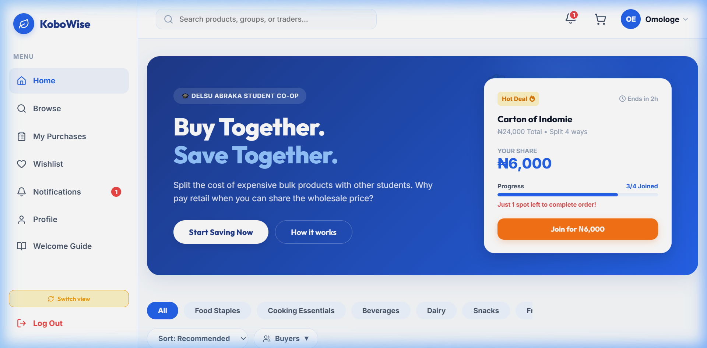
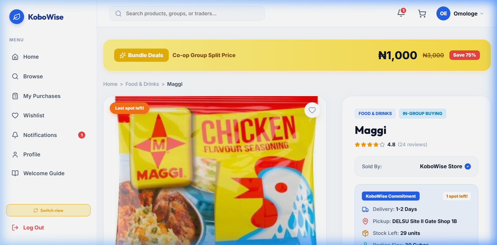
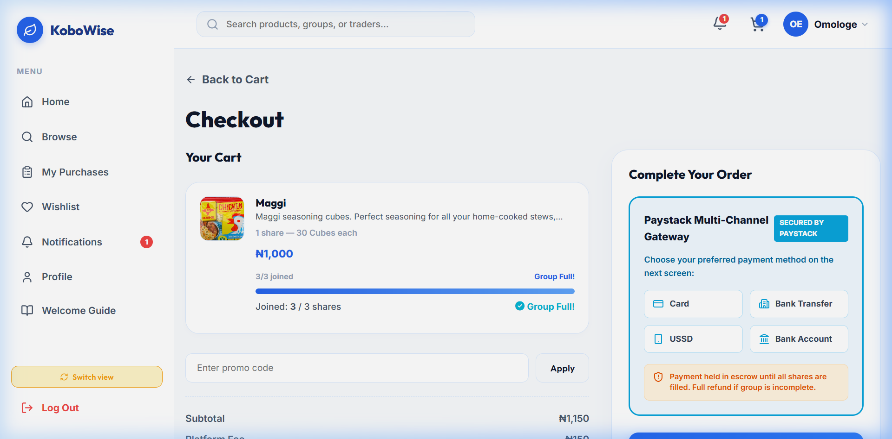
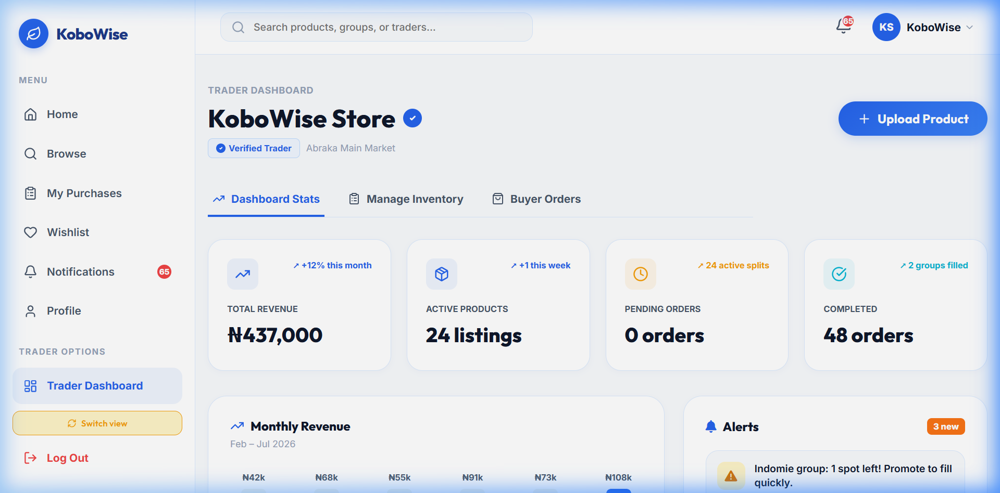
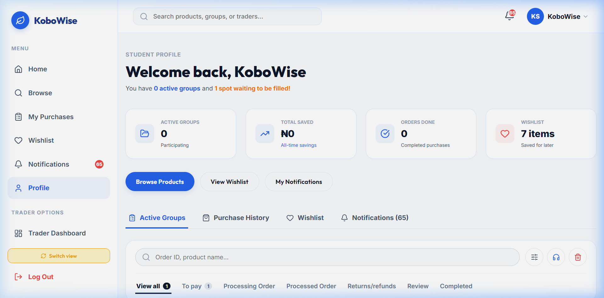

# KoboWise

Campus bulk group-buying for DELSU Abraka. KoboWise lets students pool together to buy wholesale shares of foodstuff and everyday essentials, so everyone gets bulk prices without buying in bulk alone.

## Who It's For

- **DELSU students** — buy affordable shares of bulk goods on campus.
- **Campus traders** — list products, manage bulk deals and track orders.

## Key Features

- **Group-buy pooling** — students join a bulk deal and the order is fulfilled once the pool is filled.
- **Share buying** — buy one or more shares of a bulk item instead of the whole bag.
- **Paystack checkout** — secure payments with Paystack.
- **Trader dashboard** — traders manage listings, orders and payouts.
- **Student ID verification** — verifies DELSU students before they can join deals.
- **Supabase + localStorage fallback** — data syncs with Supabase and falls back to local storage when offline.

## Tech Stack

- React 19
- TypeScript
- Vite
- Supabase
- EmailJS

## Live Demo

[https://kobowise-three.vercel.app](https://kobowise-three.vercel.app)

## Screenshots

